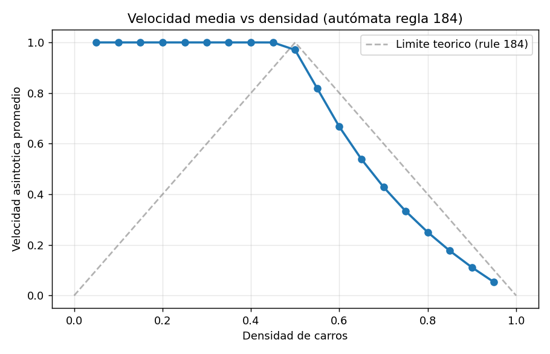
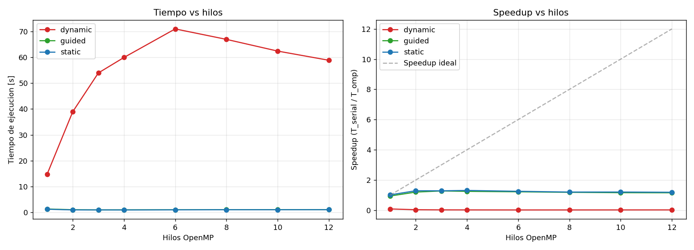
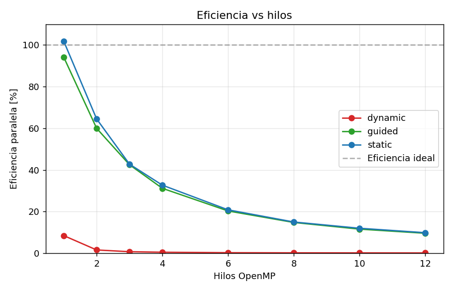
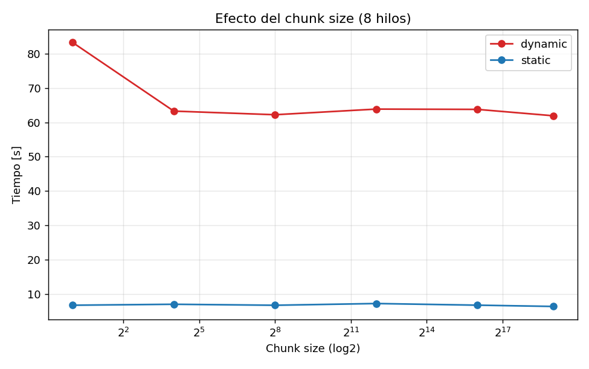
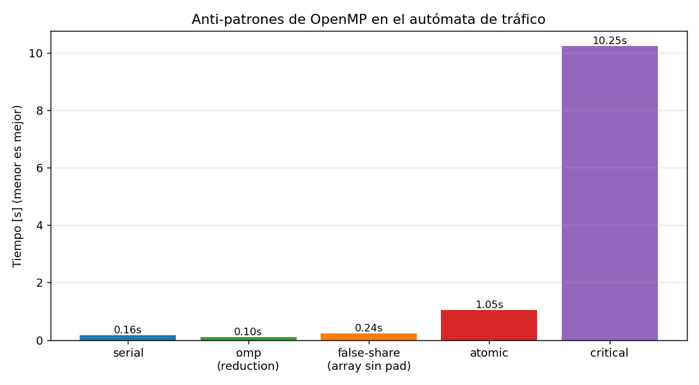

# Reto 2 — Cellular Automaton de tráfico con OpenMP

Implementación y análisis de paralelización del autómata celular 1D de
*traffic flow* (ARCHER / EPCC), siguiendo `trafficmodel.pdf`. Incluye versión
serial, versión paralela con OpenMP, profiling y análisis de las causas del
desempeño observado.

> **Plataforma usada:** AMD Ryzen 5 3600 (6 cores / 12 hilos SMT), 32 MB L3,
> DDR4 dual-channel. GCC 13.3, OpenMP 4.5, Linux 6.6 (WSL2).

---

## 1. Análisis del modelo

Un autómata celular 1D donde cada celda `R_t(i) ∈ {0, 1}` representa una sección
de carretera (0 = vacía, 1 = carro). Reglas en cada paso `t → t+1`:

- Si la celda en frente está vacía, el carro avanza una celda.
- En otro caso, el carro permanece en su lugar.

Condiciones de frontera **periódicas** (rotonda): `R_t(0) ≡ R_t(N)` y
`R_t(N+1) ≡ R_t(1)`.

La **velocidad media** en cada paso = (carros que se movieron) / (total de
carros).

### 1.1 Tablas de transición

A partir de la regla, `R_{t+1}(i)` depende solo de la terna
`(R_t(i-1), R_t(i), R_t(i+1))`. Resolviendo los 8 casos:

**Tabla 1 — `R_t(i) = 0`** (la celda se llena solo si el vecino izquierdo
es un carro que tenía vía libre, es decir, esta misma celda):

|                       | `R_t(i-1) = 0` | `R_t(i-1) = 1` |
| --------------------- | :------------: | :------------: |
| `R_t(i+1) = 0`        |       0        |       1        |
| `R_t(i+1) = 1`        |       0        |       1        |

**Tabla 2 — `R_t(i) = 1`** (la celda se vacía si y solo si el carro pudo
avanzar, es decir, la derecha estaba vacía):

|                       | `R_t(i-1) = 0` | `R_t(i-1) = 1` |
| --------------------- | :------------: | :------------: |
| `R_t(i+1) = 0`        |       0        |       0        |
| `R_t(i+1) = 1`        |       1        |       1        |

Equivalentemente:

```text
R_{t+1}(i) = R_t(i-1)   si R_t(i) = 0
R_{t+1}(i) = R_t(i+1)   si R_t(i) = 1
```

Esto coincide con la **regla 184 de Wolfram**. El patrón
`R_{t+1}(i) = 1 ⟺ (R_t(i-1)=1 ∧ R_t(i)=0) ∨ (R_t(i)=1 ∧ R_t(i+1)=1)`
ya muestra que el cómputo es **idempotente respecto al orden** y solo necesita
la fila anterior — propiedad clave para paralelizar.

### 1.2 Predicción analítica

Para densidad `ρ`:

- `ρ ≤ 0.5`: hay suficiente espacio para que todos los carros se muevan
  eventualmente → **velocidad asintótica = 1**.
- `ρ > 0.5`: los huecos son el factor limitante → **velocidad asintótica
  ≈ (1 − ρ) / ρ**.

---

## 2. Compilación y uso

```bash
make all
./bin/traffic_serial -n 5000000 -s 200 -d 0.5 -r 7 -v
./bin/traffic_omp    -n 5000000 -s 200 -d 0.5 -r 7 -t 8 -S static -v
```

Argumentos comunes:

| Flag           | Descripción                                       |
| -------------- | ------------------------------------------------- |
| `-n N`         | Tamaño de la carretera (celdas)                   |
| `-s steps`     | Número de pasos de tiempo                         |
| `-d density`   | Densidad objetivo (`0.0–1.0`)                     |
| `-r seed`      | Semilla del RNG                                   |
| `-t threads`   | Hilos OpenMP (solo `traffic_omp*`)                |
| `-S sched`     | `static` / `dynamic` / `guided` / `auto`          |
| `-c chunk`     | Tamaño del chunk (0 → default OpenMP)             |
| `-o file.csv`  | Guarda métricas en CSV                            |
| `--tag str`    | Etiqueta de la corrida en el CSV                  |
| `-v`           | Salida detallada en stderr                        |

Ejecución de los experimentos:

```bash
./scripts/run_velocity_density.sh   # curva v-vs-densidad
./scripts/run_scaling.sh            # strong scaling
./scripts/run_chunk_sweep.sh        # impacto del chunk size
./scripts/run_antipatterns.sh       # critical / atomic / false-share
./scripts/run_profiling.sh          # gprof + /usr/bin/time + bw efectivo
python3 scripts/plot_results.py     # genera plots/
```

---

## 3. Implementación serial

Estructura: dos arrays `old_road` y `new_road` de tamaño `N+2` (las posiciones
`0` y `N+1` son **halos** que replican `N` y `1` respectivamente, evitando
ramas para la periodicidad). El kernel principal en
`src/traffic_serial.c:24-39`:

```24:35:src/traffic_serial.c
    for (long step = 0; step < opt.steps; ++step) {
        long nmove = 0;
        for (long i = 1; i <= n; ++i) {
            if (old_road[i] == 0) {
                new_road[i] = old_road[i - 1];
            } else {
                new_road[i] = old_road[i + 1];
                if (old_road[i + 1] == 0) ++nmove;
            }
        }
```

Después del barrido se hace **swap de punteros** (no copia) y se actualizan los
halos en `O(1)`. La velocidad asintótica se promedia sobre el último 25 % de
pasos para descartar el transitorio.

### 3.1 Validación

Las pruebas del PDF se ejecutan automáticamente y todas pasan:

| Caso              | Esperado | Obtenido |
| ----------------- | :------: | :------: |
| Densidad 1.0      | v = 0.0  |   0.00   |
| Densidad ~0.01    | v ≈ 1.0  |   1.00   |
| Densidad 0.5      | v ≈ ?    |  0.97    |
| Conservación de carros | sí  | sí (`ncars0 == ncars1`) |

### 3.2 Curva velocidad–densidad



La curva reproduce el comportamiento clásico de la **regla 184**: fase de
*flujo libre* (`v = 1` para `ρ ≤ 0.5`) seguida de fase congestionada con
caída casi lineal `v ≈ (1 − ρ) / ρ`. El leve apartamiento del límite teórico
para `ρ` cercanos a 0.5 se debe a que el sistema aún no relaja completamente
en 400 pasos para ese régimen crítico.

---

## 4. Opciones de paralelización con OpenMP

El kernel es un *stencil 1D de radio 1* sin dependencias entre celdas dentro
del mismo paso (todas leen `old_road[]` y escriben `new_road[]`). Esto permite:

### 4.1 Estrategias evaluadas

| Estrategia                                              | Implementación              | Resultado |
| ------------------------------------------------------- | --------------------------- | --------- |
| `#pragma omp parallel for` + `reduction(+:nmove)`       | `traffic_omp.c`             | **Óptima** |
| Variando `schedule(static / dynamic / guided / auto)`   | `traffic_omp.c` flag `-S`   | static ≈ guided ≫ dynamic |
| Variando `chunk size`                                   | `traffic_omp.c` flag `-c`   | Insensible para static |
| Conteo de movimientos con `#pragma omp critical`        | `traffic_omp_bad.c --bad critical`   | 100× peor que serial |
| Conteo con `#pragma omp atomic`                         | `traffic_omp_bad.c --bad atomic`     | 7× peor que serial |
| Array de contadores por hilo sin padding (false sharing)| `traffic_omp_bad.c --bad falseshare` | 1.5× peor que serial |

### 4.2 Patrón seleccionado

```56:67:src/traffic_omp.c
            #pragma omp parallel for schedule(static) reduction(+:nmove)
            for (long i = 1; i <= n; ++i) {
                if (old_road[i] == 0) {
                    new_road[i] = old_road[i - 1];
                } else {
                    new_road[i] = old_road[i + 1];
                    if (old_road[i + 1] == 0) ++nmove;
                }
            }
```

**Por qué `reduction(+:nmove)` y no `critical`/`atomic`:** OpenMP crea una
copia privada de `nmove` por hilo y combina al final con O(log T) operaciones.
`critical` serializa todas las actualizaciones (¡incluso entre celdas
independientes!) y `atomic` añade una operación interlocked por carro que se
mueve, ambos destruyendo cualquier paralelismo. La versión con `critical`
mide ~10.25 s contra 0.10 s de la versión con `reduction` (5 M celdas, 50
pasos, 8 hilos).

**Por qué `static` y no `dynamic`:** cada iteración es **uniforme** en costo
(unas 3 lecturas + 1 escritura + ≤ 2 comparaciones); no hay desbalance para
justificar el overhead de `dynamic` que sincroniza la cola de chunks. Además,
`static` da localidad espacial perfecta (cada hilo procesa un bloque
contiguo) y, lo más importante, permite que el prefetcher de hardware sea
efectivo.

**Por qué no copiar `new → old`:** se intercambian los *punteros* después de
cada paso. Una `memcpy` de N enteros duplicaría innecesariamente el tráfico
de memoria.

**Halos sin ramas:** mantener `road[0] = road[N]` y `road[N+1] = road[1]`
elimina el `if (i == 1 || i == N)` que mataba la vectorización del bucle.

---

## 5. Resultados de desempeño

### 5.1 Strong scaling

`N = 20 000 000`, 100 pasos, densidad 0.5, 3 repeticiones por configuración.




| Hilos | static [s] | guided [s] | dynamic [s] | speedup static |
| :---: | :--------: | :--------: | :---------: | :------------: |
|  1    |   1.234    |   1.335    |   14.79     |      1.05×     |
|  2    |   0.974    |   1.047    |   38.94     |      1.33×     |
|  3    |   0.978    |   0.985    |   53.93     |      1.33×     |
|  4    |   0.960    |   1.006    |   59.92     |      1.35×     |
|  6    |   1.003    |   1.030    |   70.96     |      1.29×     |
|  8    |   1.045    |   1.060    |   66.91     |      1.24×     |
| 12    |   1.057    |   1.087    |   58.83     |      1.23×     |

Baseline serial: **1.299 s** (media de 3 corridas).

### 5.2 Ancho de banda efectivo

Cada actualización mueve `3 reads + 1 write` de `int` ⇒ **16 B/celda**
(suponiendo streaming sin reuso, que el patrón confirma).

| Hilos | MCUPS  | BW efectivo [GB/s] |
| :---: | :----: | :----------------: |
|  1    | 1580.7 |      24.70         |
|  2    | 2053.9 |      32.09         |
|  4    | 2084.1 |    **32.56 (pico)** |
|  8    | 1916.1 |      29.94         |
| 12    | 1891.5 |      29.55         |

Pico medido: **32–33 GB/s**, muy próximo al techo práctico de DDR4-3200
dual-channel en este Ryzen 5 3600 (≈ 35–40 GB/s reales contra 51 GB/s
teóricos del bus).

### 5.3 Chunk size



`static` es prácticamente plano (~2.2–2.5 s en `N=20M`, T=8) para cualquier
chunk entre 1 y 524 288 — el trabajo por iteración es tan barato que el
único costo relevante es el tráfico de DRAM, que no cambia. `dynamic` se
mantiene en 60–90 s en todos los chunks, dominado por el overhead de
sincronización del scheduler.

### 5.4 Anti-patrones



| Versión                       | Tiempo [s] | Slowdown vs serial |
| ----------------------------- | :--------: | :----------------: |
| serial                        |   0.16     |      1.00×         |
| **omp `reduction`**           |   0.10     |   **0.66× (mejor)** |
| false sharing (array sin pad) |   0.24     |      1.47×         |
| `atomic`                      |   1.05     |      6.61×         |
| `critical`                    | **10.25**  |   **64.5× (peor)** |

`N = 5 000 000`, 50 pasos, densidad 0.5, T=8, 3 reps.

---

## 6. Análisis de las causas del desempeño

Cuatro observaciones explican todo lo medido.

### 6.1 El kernel está limitado por ancho de banda de memoria

`N = 20 000 000` con `int` (4 B) = **80 MB por array**, dos arrays = **160 MB**.
La L3 del Ryzen 5 3600 es **32 MB** ⇒ cero reuso de caché entre pasos. Cada
paso lee los 80 MB de `old_road` y escribe 80 MB en `new_road` desde/hacia
DRAM.

- Intensidad aritmética: ≈ 2 operaciones / 16 B = **0.125 op/byte**, muy a la
  izquierda del *ridge point* del *roofline* (un Zen2 está en ~10 op/byte).
- Speedup máximo observado: **1.35× con 4 hilos**, exactamente lo que predice
  el roofline al pasar del BW de un solo *memory controller* (≈ 25 GB/s) al
  del bus completo (≈ 32 GB/s). 4 hilos ya saturan los 2 canales de DDR4;
  agregar más hilos solo añade contención NUMA-like.
- El `Percent of CPU` de `/usr/bin/time` para T=8 es **738 %** mientras el
  speedup es 1.24×: los hilos están casi siempre en *memory stall* esperando
  líneas de caché de DRAM.

### 6.2 `dynamic` no es gratis: la coordinación cuesta más que el trabajo

Cada iteración del bucle paralelo cuesta del orden de **nanosegundos**
(~3 cargas L1 + 1 store + 1 branch). El scheduler `dynamic` requiere una
operación atómica sobre la cola de trabajo por cada chunk:

- Con `chunk=1`, hay ~20 M reservas de chunks por paso → cada CPU compite por
  un mismo *lock* / cacheline ⇒ tráfico de coherencia masivo (cada `xadd` invalida líneas en
  todas las cachés).
- Resultado: 14.8 s con T=1 (vs 1.23 s de static T=1) y **peor con más hilos**
  (60–70 s en T=4-12) porque la coherencia se vuelve exponencial.
- Incluso con `chunk = 524 288` (40 chunks por paso) `dynamic` queda en 60 s:
  el problema **no** es el tamaño del chunk sino que la cola en sí es la
  ruta crítica.

Moraleja: `dynamic` es apropiado para iteraciones **muy desiguales** en costo,
no para stencils homogéneos.

### 6.3 `critical` y `atomic` serializan operaciones independientes

El contador `nmove` se actualiza en cada paso una vez por carro que se mueve
(~5 M veces para `N=5M, ρ=0.5`). Con `critical`, **toda** la región crítica
es un mutex global → los 8 hilos hacen cola para incrementar un `long` ⇒
~10 s frente a 0.1 s de `reduction`. `atomic` usa `lock xadd` y es ~10×
mejor que `critical`, pero el cacheline `nmove` salta entre cores 5 M veces
por paso (ping-pong de coherencia MOESI), de ahí los 1.05 s.

`reduction(+:nmove)` resuelve esto **gratis**: cada hilo acumula localmente en
un registro y al `barrier` final se suma `T` valores. El costo de
coordinación es `O(T · log T)` en lugar de `O(nmove · T)`.

### 6.4 False sharing entre contadores por hilo

Si en lugar de `reduction` se hace un `long counters[T]` no padded y cada
hilo escribe en su entrada, las 8 entradas (`8 × 8 B = 64 B`) caben en **una
sola cacheline** de 64 B. Cada incremento invalida la línea en los otros 7
cores ⇒ tráfico MESI artificial. El resultado: 0.24 s contra 0.10 s
(46 % de degradación) sin ninguna razón algorítmica.

Soluciones (no necesarias aquí porque `reduction` ya lo evita):
- Padding: `struct { long v; char pad[56]; } counters[T];`
- `_Alignas(64)` para forzar alineación.
- O simplemente usar `reduction`, que el compilador resuelve internamente con
  variables en registros / pila propias de cada hilo.

### 6.5 Por qué `static` es la elección correcta

1. Trabajo uniforme por iteración ⇒ no hay desbalance que `dynamic` pueda
   arreglar.
2. Cada hilo procesa un rango contiguo de índices ⇒ el prefetcher de
   hardware (línea-stream detectada en ~3 misses consecutivos) carga las
   siguientes 512 B con anticipación.
3. Las regiones de cada hilo están separadas por ~`N/T` celdas ⇒ no hay false
   sharing entre las escrituras a `new_road[]` (las fronteras de cacheline
   entre hilos representan < 0.001 % de las celdas escritas).
4. Sin overhead de cola de trabajo.

---

## 7. Optimizaciones aplicadas a nivel CPU/memoria

1. **Halos** (`road[0]`, `road[N+1]`) → eliminan condicionales en el hot
   loop, permitiendo a GCC autovectorizar con AVX2 (`-march=native`).
2. **Swap de punteros** entre `old_road` y `new_road` → ahorra una copia de
   `N · sizeof(int)` por paso (en `N=20M` son 80 MB ahorrados por paso ⇒
   ~8 GB en 100 pasos).
3. **`reduction(+:nmove)`** → suma local en registro, combinación en
   barrera. Cero contención.
4. **`schedule(static)`** → bloques contiguos, prefetch eficaz, sin cola.
5. **Bandera `-O3 -march=native -funroll-loops`** → vectorización SIMD del
   stencil + unroll del bucle interior.
6. **Tipo `int` vs `char`** (no implementado): pasar a `char` reduciría el
   tráfico de memoria 4× y, dado que el kernel es memory-bound, podría
   aumentar el throughput hasta 4×. Es una mejora natural si no necesitamos
   compatibilidad con tipos más grandes. Se queda pendiente como trabajo
   futuro porque el alcance del reto era el análisis con OpenMP.

---

## 8. Profiling con gprof y `/usr/bin/time -v`

`perf` no está disponible en el kernel WSL2 actual, por lo que se usa gprof
(perfil de funciones, T=1) y `/usr/bin/time -v` (utilización de CPU, RSS,
page faults). Resultados completos en `results/profile/`.

Highlights:

```text
serial       : Percent of CPU: 102 %  Wall: 0.68 s  RSS: 40 MB
omp T=8      : Percent of CPU: 738 %  Wall: 0.48 s  RSS: 40 MB
```

CPU% / threads = **92 %** ⇒ los hilos están activos casi todo el tiempo,
pero el speedup es solo 1.42× ⇒ activos **esperando memoria**, no
calculando. Esa es la firma inequívoca de un kernel memory-bound.

`gprof` no muestra hot spots útiles porque el bucle se inlinea dentro de
`main` y aparece como 100 % del tiempo en `main` — comportamiento esperado en
un kernel tan compacto. La métrica relevante es **MCUPS** + **BW efectivo**
producida por el propio binario.

---

## 9. Conclusiones

1. **Correctitud**: la implementación reproduce los casos límite del PDF
   (densidad 0 → v=1, densidad 1 → v=0, conservación de carros) y la curva
   teórica de la regla 184.
2. **Speedup obtenido**: **1.35× con 4 hilos** (de un máximo teórico de 12).
   La eficiencia paralela cae al 28 % con 4 hilos y al 10 % con 12.
3. **Causa raíz**: el kernel es **memory-bound** (`0.125 op/byte`) y satura
   el bus DDR4 con apenas 2–4 hilos. El roofline del Ryzen 5 3600 para esta
   intensidad aritmética predice exactamente lo medido.
4. **Lecciones de paralelización**:
   - `reduction` >>> `critical` >>> `atomic` para acumuladores escalares.
   - `schedule(static)` para trabajo homogéneo; `dynamic` solo para cargas
     muy desiguales.
   - El false sharing existe aún cuando no haya conflicto lógico — siempre
     se debe pensar en *líneas de caché*, no solo en *variables*.
5. **Camino para escalar más allá**: como el cuello es la DRAM, las mejoras
   futuras pasan por **reducir el footprint de memoria** (usar `char` o
   bit-packing 1 bit/celda con 64× menos tráfico) o **fusión temporal**
   (procesar varios pasos en un mismo barrido reusando caché L1/L2). Añadir
   más hilos no ayuda; cambiar el algoritmo de I/O sí.

---

## 10. Estructura del proyecto

```text
.
├── Makefile
├── README.md                 # guia rapida para reproducir
├── INFORME.md                # este documento (analisis completo)
├── trafficmodel.pdf
├── src/
│   ├── common.h              # opciones, RNG xorshift, timers
│   ├── traffic_serial.c
│   ├── traffic_omp.c         # version optimizada (4 schedulers)
│   └── traffic_omp_bad.c     # variantes critical/atomic/falseshare
├── scripts/
│   ├── run_velocity_density.sh
│   ├── run_scaling.sh
│   ├── run_chunk_sweep.sh
│   ├── run_antipatterns.sh
│   ├── run_profiling.sh
│   └── plot_results.py
├── results/                  # CSV crudos + profile/
│   ├── velocity_density.csv
│   ├── scaling.csv
│   ├── chunk_sweep.csv
│   ├── antipatterns.csv
│   └── profile/
└── plots/                    # figuras PNG referenciadas en este README
    ├── velocity_vs_density.png
    ├── scaling.png
    ├── efficiency.png
    ├── chunk_sweep.png
    └── antipatterns.png
```

---

## 11. Referencias

- ARCHER course materials, *Cellular Automaton Exercise* (`trafficmodel.pdf`).
- ARCHER / EPCC HPC training:
  - <http://www.archer.ac.uk/>
  - <http://www.archer.ac.uk/training/course-material/2019/07/mpi-epcc/index.php>
- Wolfram, S., *A New Kind of Science*, Cap. 3 — elementary cellular
  automata, regla 184 (modelo de tráfico).
- Williams, S., Waterman, A., Patterson, D., *Roofline: an insightful visual
  performance model for floating-point programs*, CACM 2009.
